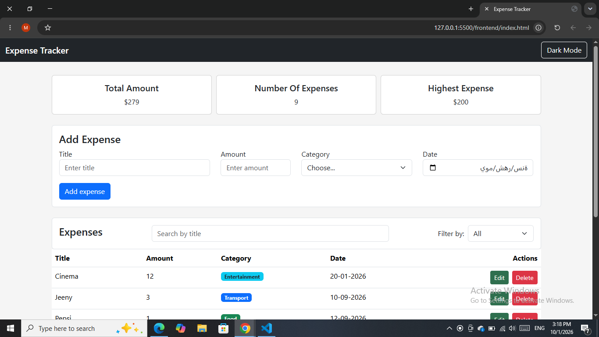
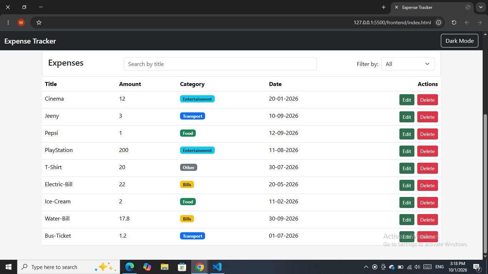
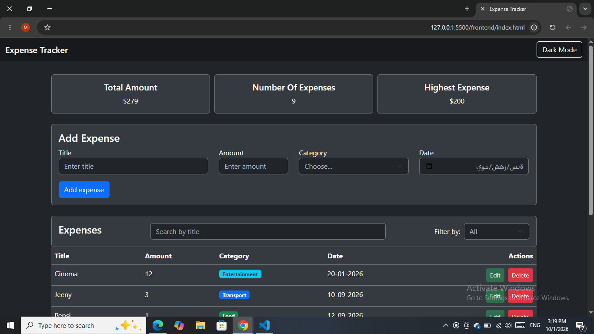
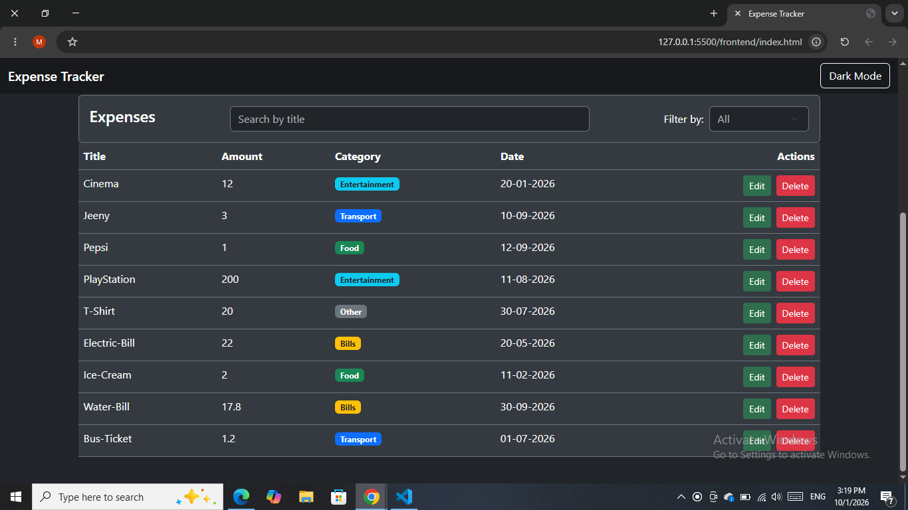
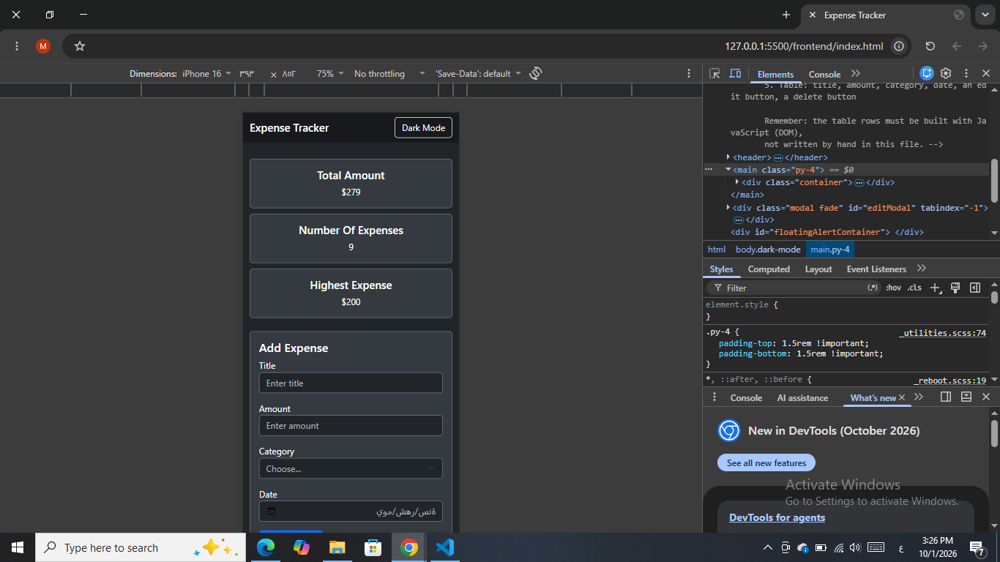
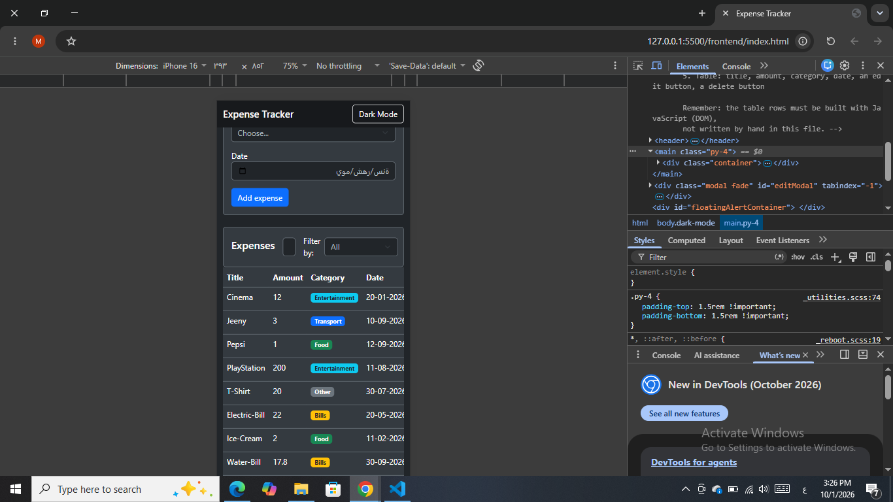
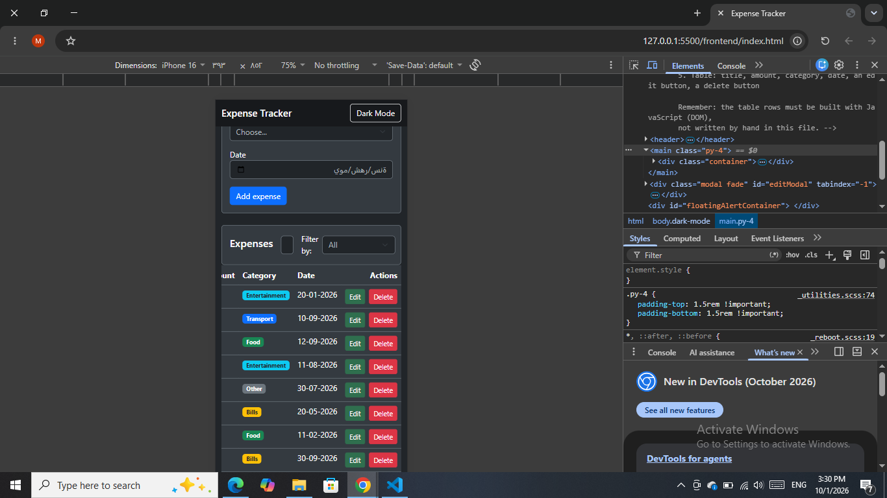

# Expense Tracker

Expense Tracker is a full-stack web application that allows users to manage their
expenses through a simple and responsive interface, the application uses a Node.js
and Express backend connected to a PostgreSQL database, while the frontend communicates with the backend using REST API requests.

## How to run

Follow these steps to run the project from scratch

**Backend**

1. Open PostgreSQL(pgAdmin) and create new database named: `expense_tracker`.

2. Open the `schema.sql` file located inside the `backend` folder.

3. Open the query tool for the `expense_tracker` database and run the entire `schema.sql` file, this will create the `expenses` table and insert the initial sample data.

4. inside the `backend` folder, create a file named `.env`.

5. Add the following configuration to the `.env` file:
```
DB_USER=postgres
DB_PASSWORD=Your_Postgres_Password
DB_HOST=localhost
DB_PORT=5432
DB_NAME=expense_tracker
```

Replace `Your_Postgres_Password` with your local PostgreSQL password.
6. Open a terminal inside the `backend` folder.

7. Install the required packages:
```bash
npm install
```

8. Start the backend server:
```batch
node server.js
```

9. The server should start on:
`http://localhost:3000`

**Frontend**

1. Open the project in Visual Studio Code.

2. Open the `frontend` folder.

3. Open `index.html` using the VS Code Live Server extension.

4. Make sure the backend server is running before using the application.

5. The Expense Tracker application will open in the browser and communicate with the backend API.

## Features

- [x] Add an expense (with validation)
- [x] Delete an expense
- [x] Edit an expense
- [x] Filter by category
- [x] Summary cards (total, count, highest)
- [x] Data is saved in a PostgreSQL database
- [x] Search expenses by title
- [x] Dark Mode
- [x] Responsive design for desktop and mobile
- [x] Loading spinner
- [x] Success and error alerts
- [x] Bootstrap modal for editing expenses

## Screenshots

### Desktop View




## Dark Mode




### Mobile view





## Video Demonstration

The video demonstrates  the application from the user perspective, including the main features and CRUD operations.

[Video link:](https://drive.google.com/file/d/1Zu5lMO3q9xK33Y4fL8b3hW7wloto6QEr/view?usp=sharing) 

## What was the hardest part?

One of the hardest parts was keeping the search and category filter working correctly after adding, editing, or deleting an expense.
Initially, after a CRUD operation, the data was refreshed from the server, but the title search was not applied again, this caused the table to display all expenses instead of keeping the current search result.
The problem was solved by updating the `refresh()` function to update the latest expenses and then call the existing `filterExpenses()` function.
This allows the current search text and selected category to be applied again after every CRUD operation.
This also keeps the frontend synchronized with the data stored in the PostgreSQL database.

## Technologies Used

- HTML5
- CSS
- JavaScript
- Bootstrap
- Node.js
- Express.js
- PostgreSQL
- pg
- dotenv
- CORS

## GitHub Repository
[View the project on GitHub](https://github.com/mahmoudalhallak97/expense-tracker.git)
